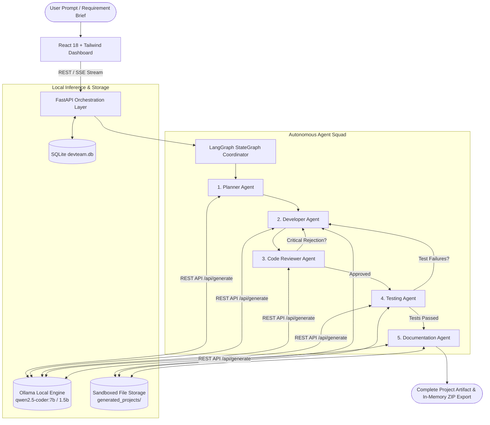
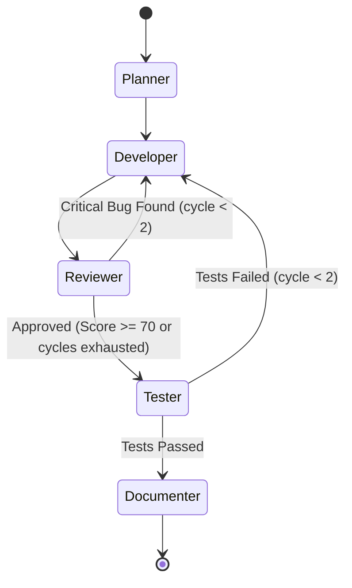

# DevTeam AI — Autonomous Multi-Agent Software Development Studio

[](https://www.python.org/downloads/)
[](https://fastapi.tiangolo.com/)
[](https://reactjs.org/)
[](https://vitejs.dev/)
[](https://github.com/langchain-ai/langgraph)
[](https://ollama.ai)
[](https://opensource.org/licenses/MIT)

**DevTeam AI** is a production-grade, privacy-first multi-agent autonomous software engineering workspace designed to run **100% locally on standard consumer hardware** (Windows 11, 16 GB RAM, CPU-only).

It coordinates a squad of **5 specialized AI agents** that plan, architect, implement, review, test, and document complete multi-file software applications from natural-language prompts. **Zero third-party cloud API keys (OpenAI, Anthropic, Gemini) are required.**

---

## 📑 Table of Contents

- [System Architecture](#-system-architecture)
- [The 5 Specialized Agents](#-the-5-specialized-agents)
- [Stateful LangGraph Workflow & Cyclical Loops](#-stateful-langgraph-workflow--cyclical-loops)
- [Key Engineering Challenges & Solutions](#-key-engineering-challenges--solutions)
- [Showcase: Generated Projects & iPhone Simulator](#-showcase-generated-projects)
- [Frontend Workspace (8 Dedicated Views)](#-frontend-workspace)
- [Getting Started](#-getting-started)
  - [Prerequisites](#1-prerequisites)
  - [One-Click Launch](#2-one-click-launch-recommended)
  - [Manual Setup](#3-manual-setup)
- [Verification & Automated Tests](#-verification--automated-tests)
- [REST API & SSE Protocol Reference](#-rest-api--sse-protocol-reference)
- [Repository Layout](#-repository-layout)

---

## 🏛 System Architecture



---

## 🤖 The 5 Specialized Agents

Each agent has a strictly bounded persona, domain-specific prompt engineering, input validation, and output parsing:

### 1. 📐 Planner Agent (`backend/app/agents/planner.py`)
- **Mission:** Transforms unstructured user briefs into complete technical specifications.
- **Outputs:** High-level system architecture, component boundaries, database schema recommendations, tech stack selection, and a prioritized list of concrete file-generation tasks.
- **Fail-Safe Mechanism:** Includes deterministic fallback task decomposition if JSON extraction from the LLM fails.

### 2. 💻 Developer Agent (`backend/app/agents/developer.py`)
- **Mission:** Writes real, syntactically complete, multi-file source code for every planned task.
- **Enterprise Standards Enforced:** Strict typing (`pydantic`, typing annotations), clean architecture, full error handling with standard `logging`, input validation, and zero placeholder stubs (`TODO`, `pass`, etc.).
- **Progress Tracking:** Emits live per-file callbacks over SSE so the user observes files being written in real-time.

### 3. 🔍 Code Reviewer Agent (`backend/app/agents/reviewer.py`)
- **Mission:** Performs comprehensive static analysis, security auditing, and architectural review.
- **Scoring & Metrics:** Produces an overall code quality score (0–100) and categorizes findings by severity: `CRITICAL`, `HIGH`, `MEDIUM`, `LOW`, and `INFO`.
- **Cyclical Feedback:** If critical security flaws or breaking bugs are detected, the reviewer triggers a cycle back to the Developer agent with specific remediation instructions.

### 4. 🧪 Testing Agent (`backend/app/agents/tester.py`)
- **Mission:** Automatically generates a comprehensive `pytest` test suite (smoke tests, boundary checks, model validations, and integration tests).
- **Sandboxed Execution:** Executes the tests in an isolated subprocess (with memory constraints and timeouts) or Docker container.
- **Auto-Healing:** If test assertions fail, the failure logs are routed back into the Developer agent's state for targeted bug fixing.

### 5. 📚 Documentation Agent (`backend/app/agents/documentation.py`)
- **Mission:** Compiles end-to-end documentation for the generated project.
- **Deliverables:** A rich `README.md`, setup runbooks (PowerShell & Bash), API contract documentation, and an executive technical audit report summarizing the agent squad's execution.

---

## 🔄 Stateful LangGraph Workflow & Cyclical Loops

The system orchestrates multi-agent state using **LangGraph**:



- **Cycle Limiters:** State maintains an `iteration_count` ensuring a hard stop at 2 feedback cycles to prevent infinite generation loops on edge cases.
- **State Channels:** Tracks `project_id`, `plan`, `generated_files`, `review_results`, `test_results`, `documentation`, `current_agent`, `status`, and `error`.

---

## 🛠 Key Engineering Challenges & Solutions

### 1. Small LLM (1.5B) JSON Code Escaping Flaw
- **Problem:** When instructing small coder models (1.5B/3B) to output multi-line code inside JSON strings (`"content": "..."`), they frequently emit placeholder strings like `"complete file content as a single string"` or fail to escape newlines and quotes.
- **Solution:** Refactored the Developer agent from JSON schema mode to **direct native code generation**. The model generates code wrapped in standard markdown blocks (` ```python ... ``` `). A custom `_clean_code()` parser extracts the block, strips language tags, validates length and syntax, and rejects placeholder strings.

### 2. Model Scalability & Upgrading to Qwen 2.5 Coder 7B
- **Evolution:**
  - Started with `qwen2.5-coder:1.5b` (986 MB) for ultra-fast startup and minimal resource usage.
  - Upgraded to **`qwen2.5-coder:7b`** (4.7 GB) with `ollama_num_predict: 2048` and `ollama_num_ctx: 4096`.
  - The 7B model provides a 4x increase in parameter capacity, allowing it to synthesize deep, enterprise-grade architectures without hitting token truncation boundaries.

### 3. LangGraph Node/State Channel Collision
- **Problem:** In LangGraph, node names cannot share identical identifiers with state channel keys. Using the node name `"documentation"` raised `ValueError: 'documentation' is already being used as a state key`.
- **Solution:** Decoupled node names from channel names by renaming the node to `"documenter"` in `graph.py` and updating routing edges accordingly.

### 4. Windows 11 CPU Optimization
- **Problem:** Large local models can saturate CPU resources, causing UI freezing.
- **Solution:** Dynamically allocated Ollama threads (`DEFAULT_THREADS = max(4, min(8, CPU - 2))`), lowered default context to optimal boundaries, and ran agents strictly sequentially through LangGraph nodes to eliminate concurrent memory spikes.

### 5. In-Memory Full-Project ZIP Streaming
- **Problem:** Exporting multi-file projects to users without leaking disk paths or leaving temporary files.
- **Solution:** Implemented `/api/projects/{id}/download` which constructs a dynamic `zipfile.ZipFile` in an in-memory `io.BytesIO` buffer and streams it with `StreamingResponse` as `application/zip`.

---

## 📱 Showcase: Generated Projects

As a concrete demonstration of DevTeam AI's output, the agent squad generated an interactive **iPhone 17 Pro Simulator** (`T:\iphn clone`):

- **Interactive Titanium Chassis:** Complete 390×844 web simulator (`index.html`) featuring:
  - Working Dynamic Island with expand/collapse animations
  - Lock screen with real-time digital clock and swipe-to-unlock gesture
  - Home screen with app icon grid and notification badge counts
  - Functional iOS Calculator app
  - Notes app with live state management
  - Settings app displaying hardware specifications
- **FastAPI Backend (`main.py`, `models.py`, `routes.py`):**
  - Serves both the interactive simulator and REST API
  - Pydantic V2 models with field bounds and timezone-aware timestamps
- **Automated Tests:** 28 passing `pytest` integration and unit tests (`tests/test_api.py`, `tests/test_main.py`).

---

## 🖥 Frontend Workspace

Built with **React 18**, **TypeScript**, **Vite**, **Tailwind CSS**, and **Lucide Icons**, featuring 8 specialized views:

| Page | Description |
|---|---|
| **Dashboard** | Overview of projects, system health, local model status, and quick-start actions |
| **New Project** | Interactive wizard to input requirements, select tech stacks, and configure agent parameters |
| **Agent Workspace** | Live Server-Sent Events (SSE) terminal, real-time agent status pills, node workflow visualizer, and Restart/Resume controls |
| **Code Workspace** | Monaco-style syntax viewer, directory tree explorer, file size stats, and **One-Click ZIP Download** |
| **Code Review** | Audit cards, quality score gauge (0–100), severity-badged findings, and suggested fixes |
| **Testing Workspace** | Pytest execution results, pass/fail status cards, duration metrics, and stdout/stderr console logs |
| **Documentation** | Formatted Markdown viewer for generated READMEs, runbooks, and audit logs |
| **Project History** | Searchable audit trail of all projects with cycle counts, timestamps, and quick navigation |

---

## 🚀 Getting Started

### 1. Prerequisites

1. **Python 3.11+** installed and added to `PATH`.
2. **Node.js 18+** & `npm` installed.
3. **Ollama** installed from [ollama.com](https://ollama.com).

Pull the desired model:
```bash
# Recommended (highest quality code)
ollama pull qwen2.5-coder:7b

# Lightweight alternative (fastest execution)
ollama pull qwen2.5-coder:1.5b
```

### 2. One-Click Launch (Recommended)

Double-click or run the launcher script from the repository root:

```cmd
# Windows Command Prompt / Batch
start-devteam.bat
```

```powershell
# Windows PowerShell
.\start-devteam.ps1
```

The script verifies Ollama, starts the FastAPI backend on port 8000, starts the Vite frontend on port 5173, and opens your default browser automatically.

### 3. Manual Setup

#### Backend Setup
```powershell
# Navigate to repo root
cd T:\llmproject

# Create & activate virtual environment
python -m venv .venv
.\.venv\Scripts\Activate.ps1

# Install dependencies
pip install -r backend\requirements.txt

# Start backend server
cd backend
python -m uvicorn app.main:app --host 127.0.0.1 --port 8000 --reload
```

#### Frontend Setup
```powershell
# In a separate terminal
cd T:\llmproject\frontend

# Install dependencies
npm install

# Start Vite dev server
npm run dev
```

Open your browser at **http://localhost:5173**.

---

## 🧪 Verification & Automated Tests

### Backend Unit & Integration Tests
```powershell
# Run all 10 core backend tests
.\.venv\Scripts\pytest.exe -v
```

Expected output:
```
tests/test_agents.py::test_extract_json_direct PASSED
tests/test_agents.py::test_extract_json_markdown_block PASSED
tests/test_agents.py::test_extract_json_fallback_empty PASSED
tests/test_agents.py::test_graph_topology_compilation PASSED
tests/test_api.py::test_path_traversal_prevention PASSED
tests/test_api.py::test_safe_join PASSED
tests/test_api.py::test_full_project_lifecycle PASSED
tests/test_health.py::test_health_ok PASSED
tests/test_health.py::test_model_status_shape PASSED
tests/test_health.py::test_create_and_list_project PASSED
======================= 10 passed in 2.29s =======================
```

### Frontend TypeScript & Production Build
```powershell
cd frontend
npm run build
```

---

## 📡 REST API & SSE Protocol Reference

| Endpoint | Method | Description |
|---|---|---|
| `/health` | `GET` | Health check and local Ollama model connectivity |
| `/api/projects` | `GET` | List all created projects |
| `/api/projects` | `POST` | Create a new project and initialize workflow |
| `/api/projects/{id}` | `GET` | Retrieve complete project metadata and agent state |
| `/api/projects/{id}/start` | `POST` | Trigger asynchronous LangGraph execution |
| `/api/projects/{id}/resume` | `POST` | Resume or retry execution from last checkpoint |
| `/api/projects/{id}/stream` | `GET` | Server-Sent Events (SSE) live streaming feed |
| `/api/projects/{id}/files` | `GET` | List generated files with sizes and language tags |
| `/api/projects/{id}/files/{path}` | `GET` | Read contents of a generated source file |
| `/api/projects/{id}/download` | `GET` | **Download full project as a `.zip` archive** |
| `/docs` | `GET` | Interactive Swagger API documentation |

---

## 📂 Repository Layout

```
T:\llmproject\
├── backend/                         # FastAPI Python Backend
│   ├── app/
│   │   ├── agents/                  # 5 Specialized AI Agents
│   │   │   ├── base.py              # Ollama REST client & JSON parser
│   │   │   ├── planner.py           # Planner Agent
│   │   │   ├── developer.py         # Developer Agent (direct code gen)
│   │   │   ├── reviewer.py          # Code Reviewer Agent
│   │   │   ├── tester.py            # Pytest Generator & Runner
│   │   │   └── documentation.py     # Documentation Agent
│   │   ├── api/                     # REST Endpoints
│   │   │   ├── health.py            # Health & Ollama status
│   │   │   └── projects.py          # Project CRUD, SSE stream & ZIP export
│   │   ├── models/                  # SQLAlchemy ORM Models
│   │   │   ├── project.py           # Project state schema
│   │   │   └── base.py              # Database engine & session
│   │   ├── orchestration/           # LangGraph StateGraph
│   │   │   ├── graph.py             # Workflow graph builder
│   │   │   ├── nodes.py             # Agent execution nodes
│   │   │   └── state.py             # WorkflowState schema
│   │   ├── services/                # Supporting Services
│   │   │   ├── file_manager.py      # Path traversal guards & safe I/O
│   │   │   └── project_service.py   # Background thread runner
│   │   ├── config.py                # Pydantic environment settings
│   │   └── main.py                  # FastAPI application entry point
│   └── requirements.txt             # Backend dependencies
├── frontend/                        # React 18 + Vite + Tailwind CSS
│   ├── src/
│   │   ├── pages/                   # 8 Dedicated Workspaces
│   │   │   ├── Dashboard.tsx        # Overview & metrics
│   │   │   ├── NewProject.tsx       # Project creation wizard
│   │   │   ├── AgentWorkspace.tsx   # Live SSE terminal & node graph
│   │   │   ├── CodeWorkspace.tsx    # Syntax viewer & ZIP download
│   │   │   ├── CodeReview.tsx       # Security & quality audit cards
│   │   │   ├── Testing.tsx          # Pytest results & console
│   │   │   ├── Documentation.tsx    # Markdown documentation viewer
│   │   │   └── History.tsx          # Project audit trail
│   │   ├── services/api.ts          # Axios REST client & SSE consumer
│   │   └── types/index.ts           # TypeScript interfaces
│   ├── package.json                 # Node dependencies
│   └── vite.config.ts               # Vite configuration
├── tests/                           # Pytest Test Suite
│   ├── test_agents.py               # Parser & graph topology tests
│   ├── test_api.py                  # API endpoints & traversal guards
│   └── test_health.py               # Health & project creation tests
├── generated_projects/              # Sandboxed output directory for AI projects
├── start-devteam.bat                # 1-Click Windows batch launcher
├── start-devteam.ps1                # 1-Click PowerShell launcher
├── pytest.ini                       # Pytest configuration
├── .gitignore                       # Git ignore rules
└── README.md                        # Master documentation (this file)
```

---

## 📄 License

This project is licensed under the [MIT License](LICENSE).
